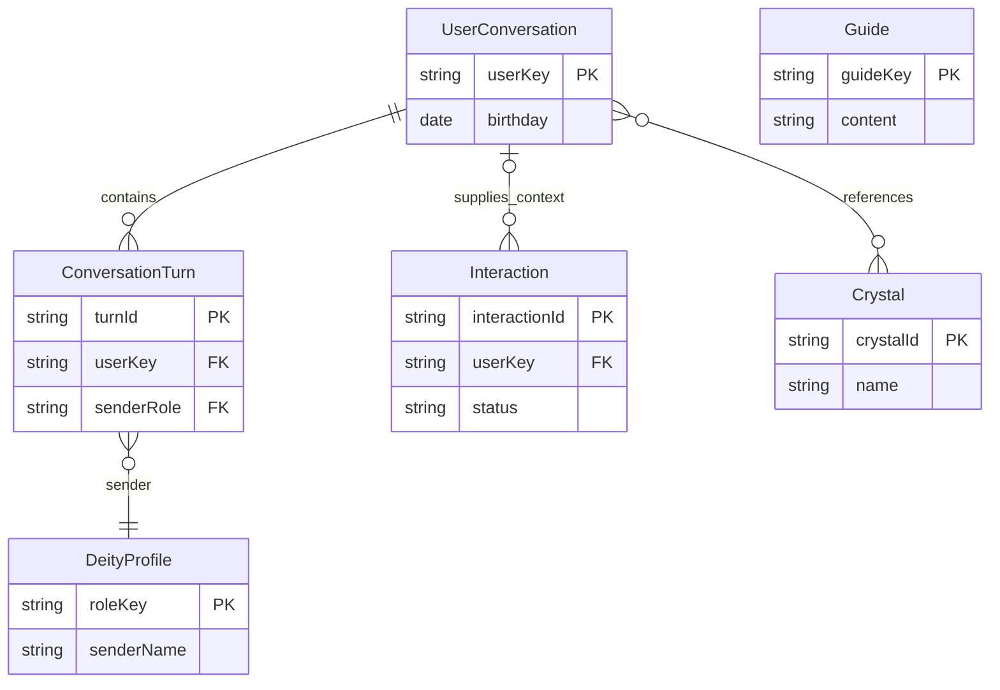

# Zona Crystal — 最小功能行為規格

## Sources

- [已確認問答](functional-design-questions.md)、[實體來源](entities.md)、[規則來源](rules.md)。
- [U1定義](../../../inception/units-generation/unit-of-work.md)、[U1故事](../../../inception/units-generation/unit-of-work-story-map.md)、[全部AC](../../../inception/user-stories/stories.md)。
- [需求](../../../inception/requirements-analysis/requirements.md)、[四元件](../../../inception/domain-design/components.md)、[C1–C5契約](../../../inception/contract-design/contract-summary.md)、[互動設計](../../../inception/refined-mockups/interaction-spec.md)。

## Scope & Ownership

U1同一應用交付全部17故事／52AC。本機與LINE共用行為；BotExperience協調其餘三元件，不將Guide／UI拆新服務。CrystalKnowledge唯讀內容與確定性規則，Consultation只用當前身分必要上下文，ConversationMemory唯一讀寫持久聚合。本文件是流程及狀態機來源；資料形狀見entities，決策邏輯見rules，不以設計通過宣稱已運作。

最薄生日旅程先做，完成條件仍含Echo、文字／圖片、持久記憶與A/B、三追問及額外捷徑、四角色、雙選單、六指南、動畫與全功能教學。具體工具選型在後續最小設計，這裡不增加正式部署／多程序架構。

## Ordered Entry & Dispatch Flow

1. 入口先檢查有界body／必要格式。真實LINE先驗原始body簽章再解析事件，401無模型／記憶副作用，設定不足503；合法空events回200。
2. 依C1/C2映射可信身分與明確action；A/B只由本機選擇映射，LINE只取已驗userId，缺userId的group/room事件略過。拒絕客戶端額外userKey／source／provider。
3. 建立Interaction及原30秒絕對期限；同使用者排隊，排隊等待算在總預算內。取得必要記憶後才決定會受mode／cards／birthday影響的行為。未讀回明示，不讀另一人的資料。
4. 明確set-mode優先；文字「Echo」進入echo，「退出 Echo」「離開 Echo」「結束 Echo」返回consult，且退出不作回聲。依原字串大小寫／空白的既有相容入口可加別名，不重新解釋一般回聲內容。
5. 若其餘文字或圖片且mode=echo：文字原樣回聲；圖片回文字模式提示，不呼叫模型。明確guide／set-menu等教學控制仍可操作，不暗中把mode改成consult。
6. consult一般文字依序辨識六指南別名、原switch資料、#水晶／今日水晶推薦、明確完整生日候選及生命靈數捷徑；其餘走文字諮詢。明確action直接進對應流程，不能被另一分支誤吞。
7. 對必要變化建立候選聚合，向ConversationMemory保存；read-failed或過期不開始保存。read與write結果獨立回傳，候選畫面不冒稱已持久化。
8. LINE回覆／本機結果使用同一內容投影；記錄交付狀態，終了等待。外部失敗仍有可修正／重試入口，下一操作先重新讀取持久狀態。

一般文字中的日期須可辨識完整候選；正常星座／水晶問題不因沒生日而失敗。指南先於文字諮詢；在Echo中一般指南文字仍按文字Echo，使用者可按明確指南控制或先退出。此優先序避免新功能破壞原樣回聲。

## Birthday, Life Path & Recommendation Flow

1. 明確birthday action缺dateText回INVALID_BIRTHDAY。辨識YYYY-MM-DD、YYYY/MM/DD、YYYY年M月D日、空白分隔年月日及YYYYMMDD，可嵌入自然語句。
2. 年份恰四位0001–9999，分隔形式月日一或兩位，緊湊形式恰八位；數字邊界避免從更長序號截出生日。明確生日語句卻缺資料／無效候選，以及多個不同日期要求修正；同一日期重複出現可合一。
3. 驗月份1–12，按該年公曆每月天數驗日。閏年是能被4整除且不能被100整除，或能被400整除；2000-02-29有效，2001-02-29／2000-02-30無效。不要容忍日期溢位，不新增年齡／未來日期限制。
4. 有效日期正規YYYY-MM-DD；相加八位年月日數字，反覆相加直到1–9。四個固定例子4／2／4／6依BR8.2；不保留11/22/33。
5. 從原七款池以無偏差洗牌或等價均勻不放回抽樣取三個；當次三ID不同，清除舊selectedCrystalId，保留原卡名稱、簡介／圖片與動作。
6. 回birthday、lifePath、三卡及額外日期／生命靈數捷徑，保存有效生日及卡ID／必要文字。保存失敗答案仍可讀，明示尚未保存；下次需重讀。
7. 無效日期回修正訊息，不生成新數字／卡、不改舊有效生日／卡。已有舊結果需標為先前資料，不把它當本次成功；修正後可直接完成。
8. recommend獨立走第5步，不要求生日；#水晶／今日水晶推薦入口保留。life-path依已讀有效生日計算，形成原問題「老師，請幫我解析我的生命靈數是 N」，再走文字諮詢並取得角色／三追問，不重新抽卡；缺生日提示先選日期。本機action由伺服器形成該題，LINE捷徑直接送同一完整題文。

水晶池：紫水晶、粉晶、黃水晶、綠幽靈、白水晶、黑曜石、鈦晶。卡片不要求固定順序或同生日固定結果，教學內容不宣稱療效／命運判斷。

## Select Crystal & Follow-Up Flow

1. 從目前身分已讀recommendationIds或本次同互動已產生的三卡驗ID；須同時在原池與當前三卡。未知／過期／他人選卡回UNKNOWN_CRYSTAL或要求重選，不猜內容。
2. 找出該卡原introduction與名稱，回同一卡投影；基本內容不需模型成功才可讀。
3. 呈現有效sender（確定性水晶介紹預設COSMOS）與恰三個不同相關可點追問；可用真實追問結果，缺漏／失敗則相關教學替代題並標來源。
4. 保存selectedCrystalId與必要介紹／描述回合。追問按完整題文走follow-up action，後续以text consultation處理；不只驗按鈕存在。
5. 日期捷徑另保留，有效生日才帶生命靈數捷徑；LINE顯示label可依平台長度縮短，送出題文不能被截短。
6. 圖片無法載入保留名稱、介紹、選卡動作；三卡各可依序點選，不因第一次selected便禁用其他兩卡。

## Text & Image Consultation Flow

1. text／follow-up檢查非空及4000字元上限，保持待送完整文字；image檢查允許MIME、嚴格解碼及檔頭與MIME一致，5MiB上限。LINE圖片由可信messageId取得，同樣驗內容；不是只把URL／固定描述傳模型。
2. 顯示「正在整理回覆」，本機標「LINE 操作模擬」。真實可用個人情境盡力提示Loading Animation；失敗不阻擋內容處理，不讓提示獨占剩餘期限。
3. Consultation只接當前身分必要生日／文字歷史／回覆／圖片描述與輸入，無持久讀寫權限。持久保存全部必要歷史；供模型的上下文可只選近期或相關必要回合，不刪掉儲存歷史。
4. example明確走可重現固定回覆；文字就近標「教學範例回覆」、圖片標「圖片辨識範例，非真實辨識」。記憶回憶仍讀實際資料，不能以固定答案假冒持久性。
5. real走已保留模型入口，文字傳文字、圖片傳實際bytes/MIME；設定不足或主答案失敗明示，不轉成功例子。主答與追問共用剩餘30秒，供應商晚到答案不顯示／不保存。
6. 有效角色使用原名稱／頭像：ATHENA「智慧守護神 雅典娜」、VENUS「金星守護神 維納斯」、FORTUNE「命運之輪 莫伊萊」、COSMOS「星曜守護導師 艾蓮」。未知／缺角色回COSMOS，去除[DEITY: ...]技術標記。頭像失敗名稱仍可讀。
7. 教學四組原輸入分別為學習專注、愛情／人際、財運起伏及水晶基礎鑑定，對應上述四角色；真實角色選擇沿用原主題／有效結果，不把固定示例推論成外部品質。
8. 主答成功後保留恰三個非空不同相關問題；不足時用相關教學替代問題並就近標「教學替代問題」。主答失敗不以追問掩飾。
9. 形成必要文字／答案或imageDescription回合並保存，圖片bytes在本次使用後釋放。結果與memoryStatus各自顯示，任何結束路徑都釋放等待；前端35秒保護，下一操作可正常執行。

## Persistent Memory, Legacy Projection & Concurrency

### Ordered Read / Update

1. 伺服器構造userKey，含appName、demo/line namespace及可信身分；資料位置不直接拼接任意客戶端字串。依同userKey序列處理所有讀取／變化，A與B不共用可變歷史。
2. 取得序列執行權後從實際儲存讀取。空與讀取失敗分開；不存在才用birthday=null、consult/main、空卡／turns初值。
3. 依有界期限處理功能，建立當前讀回revision上的候選狀態與新回合；不以程序啟動初值作來源。recall只讀必要已存文字，不保存完整回憶副本；空資料清楚說沒有先前內容。read-failed時實際舊模式未知，若使用者繼續則採明示的暫時consult預覽，不宣稱已載入mode／menu；生日／三卡可作未保存預覽，依舊生日或卡ID的動作要求先重讀／重選。
4. 保存前再檢查期限；以不可分割的聚合提交方式避免可讀半份新狀態。具體儲存工具後續選型，新版聚合內state／turns一次一致提交，成功revision+1。
5. 明確完成才saved；已知拒絕write-failed；已提交但逾時／斷線不能判定結果則outcome-unknown。答案與候選可顯示，但明示未確認保存，下一操作以重讀為準。
6. 未結束的原保存保持該身分的持久操作阻擋標記；後續請求不能讀陳舊snapshot後覆寫。其讀取在共用deadline內回read-failed，非持久諮詢可明示無歷史／不保存；原操作真正結束後解除標記，下一次重讀再處理。
7. 過期前尚未提交不得再提交；已提交不能宣稱已取消或回滾。晚到主答案不形成回合；晚到保存只更新操作觀測，不更改新畫面、不自動重送。
8. 一個應用程序是MVP執行邊界；不平行開第二個寫入程序。多程序鎖、跨重啟exactly-once、防重及進程崩潰前仍在第三方進行的寫入延後並明列限制。operator reset先停止服務、依文件確認資料邊界，這次不執行破壞性操作。

### Existing Memory Compatibility

保留原collection crystal_memories；LINE appName=CrystalAstrology，userId只能來自驗證事件；demo用獨立namespace，禁止把A當作真實LINE身分。

|原欄位／來源|讀取投影|新版保存|
|---|---|---|
|appName、userId|查詢與二次檢查都符合當前可信身分|保留原命名，內部namespace另辨識|
|sessionId|原session讀取唯讀|新版專屬zona_v1_加可信namespace/identity的穩定摘要，不撞原session_<userId>|
|events[].content.parts[].text|只取文字內容為必要歷史，跳過非文字parts，不保存原圖片|新版Turn投影成必要文字events，每個turnId穩定對應，不重複加入|
|events[].author|可辨識user則inputText，其餘來源文字作replyText／歷史，不猜主題角色|user輸入事件及角色答案事件保留author|
|events[].timestamp、lastUpdateTime|有效timestamp優先，否則有效lastUpdateTime；均無效createdAt=null|新回合有效createdAt及lastUpdateTime，不捏造舊時間|
|舊doc ID＋event index|sourceRef／turnId供去重及穩定順序|不複製回原doc，不改原events|
|新schemaVersion、revision、normalized state／turns|驗必填／身分／關聯，正規化資料作狀態來源|新增版本化專屬記錄，聚合一次提交|

1. 先讀專屬新版記錄並驗schemaVersion與身分；無新版才用初值。再查同appName/userId原記錄取得必要文字來源；原資料不是空記憶。
2. 原doc保持唯讀，不保存回原session。新版記錄只寫新版state／turns及其events投影，原歷史不複製回新版events造成重複；供顯示／context時合併唯讀原來源與新版turns。
3. 來源ID以doc ID＋event index穩定去重，排序依有效時間、來源ID及原index；不靠無序查詢推測先後。舊內容只作歷史，不由任意舊文字推測持久mode／menu／birthday；新版有效狀態才是這些欄位來源。
4. 新版記錄格式／身分不符，或必要原讀取失敗，回read-failed且禁止保存；不能把部分讀取成功冒稱完整loaded後覆寫。原不支援parts只略過該part，不刪原資料。
5. 沒有破壞性遷移／live資料寫入證據。外部讀寫由替身與資料樣本驗證相容映射，真實外部結果仍另列待驗證。

## Menus, Guides, Echo & Identity UI

- 主／五宮格預覽保留原素材與各格動作，分享URL維持https://github.com/zonawang/zona-ai-learning-lab。原alias_main_menu／alias_five_grids及switch-to-main-menu／switch-to-five-grids維持。
- 原生alias切換與伺服器已設定menu ID切換路徑都保留；本機預覽只標模擬。真實applied才確認實際menu；failed／outcome-unknown保留先前已確認menu與返回文字入口，不宣稱成功。
- 六指南字串均回原內容；使用指南包含日期、卡片、Echo可發現入口；圖片失敗文字／返回仍可用。
- 進Echo顯示mode=echo，退出文字不Echo；圖片提示。若模式保存失敗，本次畫面標尚未保存，後續以重讀結果為準，不能假冒重啟後仍保存。
- 切身分立刻增加displayGeneration、清空答案／三卡／追問／生日／history／mode快取；取消或忽略舊請求的畫面更新，GET只讀新身分。已提交A操作仍可依原A保存，絕不能改成B。
- 同畫面一次提交，在途提交控制停用但身分選擇／必要返回可用；所有網路終止路徑釋放等待。新身分載入失敗顯示重試，不借用舊視圖。
- 375／1280下卡片可直向排列，三追問與額外捷徑換行；原生控制、label、可見焦點、穩定data-testid、圖片alt、文字錯誤及狀態讀取保留。文字結果以文字呈現，不執行模型／使用者HTML。

## Lifecycle State Machines

### Interaction

|起點|事件／條件|下一狀態|作用|
|---|---|---|---|
|accepted|格式及可信身分成立、取得執行權|loading-memory|依當前userKey讀取|
|loading-memory|empty/loaded/read-failed|processing|帶明確read狀態；失敗只允許非持久行為|
|processing|必要變化且可保存／仍有期限|saving|提交候選聚合一次|
|processing|讀取失敗、純查詢或無變化|delivering|not-attempted；回應如實標示|
|saving|saved/write-failed/outcome-unknown|delivering|答案與write狀態分開|
|delivering|結果／平台回覆交付|completed|釋放等待，外部結果獨立記錄|
|任何未結束|已知驗證／主模型／交付錯誤|failed|安全錯誤，不造成功結果|
|任何未結束|共用期限已過|timed-out|不開始新工作，忽略晚到顯示|

completed、failed、timed-out皆為該Interaction終點；重試是新Interaction，不重播原replyToken或未知提交。寫入未知的持久阻擋標記生命週期獨立於終點，實際原操作結束才解除。

### UserConversation & Frontend

|狀態／欄位|動作|轉移|
|---|---|---|
|mode consult/echo|set-mode或進出文字|改候選mode；保存成功才持久|
|menu main/five|set-menu|模擬預覽切換，或真實applied確認；失敗不偽造|
|無／舊birthday|有效生日|候選新birthday、三ID、selected=null|
|任意birthday|無效日期|狀態不變；顯示本次錯誤|
|三ID|有效選卡|selected=該ID，其餘卡仍可選|
|任意卡|重新recommend|三個新ID、selected=null|
|前端idle|新提交|waiting並綁身分／世代|
|前端waiting|成功／失敗／35秒|idle、結果／錯誤可讀|
|任何畫面|切A/B|cleared→loading-state→新idle或可重試錯誤|

## Derived Entity Relationship View

以下圖由entities.md關聯衍生，不是另一份資料定義。已在寫入前以Mermaid parser檢查。

文字替代：Conversation擁有同身分零至多Turn；Interaction可使用零或一份已讀Conversation；推薦／選卡引用Crystal而不轉移擁有權；每個Turn引用四角色之一。圖的多對多符號摘要Crystal引用，實際推薦上限零或三及選卡子集以YAML約束為準。Guide獨立唯讀，actions是值而不是新關聯。

## Derived Rules Summary

|規則|行為摘要|
|---|---|
|BR1.1|入口可信身分與共用行為|
|BR1.2|Echo與退出的優先序|
|BR2.1|文字諮詢、例子與真實失敗|
|BR2.2|圖片格式、真實bytes與描述|
|BR3.1|必要記憶先讀再更新及重啟|
|BR3.2|身分與A/B畫面隔離|
|BR3.3|保存狀態與答案分開|
|BR3.4|舊資料唯讀投影與單程序序列|
|BR4.1|三個追問及完整題文|
|BR4.2|額外日期與生命靈數捷徑|
|BR5.1|四角色與COSMOS預設|
|BR6.1|雙選單與非破壞切換|
|BR6.2|六指南與可發現入口|
|BR7.1|共用期限及等待復原|
|BR8.1|原日期形式與有效公曆|
|BR8.2|生命靈數反覆縮減1–9|
|BR9.1|原七款池三卡不放回|
|BR9.2|選卡與當前三卡一致|
|BR10.1|教學頁完整操作與易用性|
|BR10.2|可重現交付及資料復原|
|BR10.3|公開資料與秘密界線|
|BR10.4|需求與元件關鍵驗證|
|BR10.5|證據分列與最小診斷|

規則內容與來源只以rules.md的YAML為準；上述是閱讀視圖。

## Critical Scenarios & Test Handoff

|範圍|最小可重現條件|
|---|---|
|入口／Echo|合法／無效簽章、空events、未知事件與缺userId；原樣Echo、各退出入口、Echo圖片與下一諮詢|
|日期／計算／卡|全部文字形式、嵌入／picker、閏日／無效後修正、11/22/33縮減、均勻不重複三卡及逐卡正確介紹、獨立推薦無生日|
|文字／圖片／角色／追問|實際傳入text／bytes/MIME替身，格式／過大／取得失敗，四角色原示例及未知角色、三追問逐題完整內容、缺追問相關替代|
|記憶|A真實儲存→B無A→A讀回→新程序／reader重讀；空／讀／寫失敗；只存必要文字；舊資料投影、原events不變、新記錄避撞|
|競爭／晚到|同A兩请求序列、排隊期限、保存未知阻擋直到原操作結束再讀、過期主答不保存、切B忽略A顯示且A不寫B|
|選單／指南／等待|兩選單往返、六指南、圖／頭像失敗文字入口、動畫失敗不擋主答、成功／拒絕／timeout後可操作|
|UI／交付|375/1280、鍵盤／焦點／標籤與圖片alt；範例就近標示、受限靜態路徑、安全診斷、本機與CI同命令及文件清單|

每個AC都在traceability.json對到存在BR；後續test-after逐需求／元件驗證，不把這份scenario或diagram解析當測試通過。實際Construction Verification Command維持尚未選定，待可執行檢查建成後人工作答授權，不能用文件驗證冒充。

## Known Limits & Deferred Items

單程序、本機展示、沒有正式SLA／多程序鎖／跨重啟防重／背景佇列／正式雲端發布。單項問題十分鐘停損，先簡化裝飾／非核心整備，保留全部原功能。資料重設不自動執行，恢復前版保留記憶；具體安全命令與可重現交付在實作／Operation記錄。外部憑證與LINE／模型／真實持久服務成效待驗證，本機例子與替身不代表外部通過。

## Assumptions & Open Questions

None. 功能與資料語義足夠實作；具體工具、取消／原子保存方式由後續最小設計選擇，不新增產品方向或破壞性遷移。
