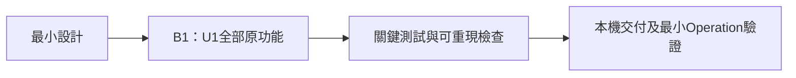

# Zona Crystal — 一日建置與交付計畫

## Sources

- [delivery-planning-questions.md](delivery-planning-questions.md)：已確認單批次、單一工作階段、8小時排程及Defer selection。
- [unit-of-work.md](../units-generation/unit-of-work.md)、[dependency](../units-generation/unit-of-work-dependency.md)、[story map](../units-generation/unit-of-work-story-map.md)：唯一U1、零依賴、全部17故事。
- [requirements.md](../requirements-analysis/requirements.md)、[stories.md](../user-stories/stories.md)、[components.md](../domain-design/components.md)、[contract-summary.md](../contract-design/contract-summary.md)：全部驗收與四元件／五契約。
- [team-practices.md](../practices-discovery/team-practices.md)：main基準、短期分支／worktree、squash、test-after、本機交付。

## Work Streams & Bolt Sequence

Bolt是一次完成一組工作、以可運作成果結束的建置批次。本次只有B1；不重拆已核准Unit，不新增平行批次。

| Sequence | Bolt ID / Slug | Unit | Kind | Stories | Ownership | Dependencies |
|---|---|---|---|---|---|---|
| 1 | B1 / zona-crystal-full-demo | U1 / u1-zona-crystal-bot | service | 全部17個Must故事 | 既有單一產品工作群組，Codex主責 | 無其他Unit |

同一工作串流涵蓋BotExperience、CrystalKnowledge、Consultation、ConversationMemory及六實體；相對複雜度L，反映功能整合量，不代表額外工期。來源重用、身分／記憶／外部失敗是主要變動範圍；不用七套獨立伺服器或新平台。

## B1 — Implementation Sequence & Expected Demo

U1內先打通生日→生命靈數→三張不同卡→選卡介紹的最薄旅程，再依已核准Unit內故事次序補齊其他原功能。每個適用可測層採test-after：實作該層、補測試、通過後整合。早期切片可展示但不等於B1完成。

- 入口與教學殼→生日／1–9／三卡／介紹，建立可啟動整合結果。
- 盡早驗證實際持久記憶、A／B隔離與新讀取實例／重啟，避免後續功能依賴錯誤記憶假設。
- Echo、雙選單／六指南、文字／四角色／三追問＋捷徑、圖片與等待復原，整合至同一應用。
- 完整本機教學操作、逐需求與逐元件關鍵檢查、375／1280與鍵盤、安全素材／秘密／驗簽檢查。
- 交付README／示範清單／限制、同命令本機與CI檢查及最小Operation驗證。

關鍵交付鏈是可啟動共用入口→核心日期／卡片行為→正確持久與身分→全部功能整合→關鍵檢查→本機展示。DAG只有U1，沒有跨Unit拓撲偏離；這裡是交付優先順序，不能修改runtime的Unit邊界。

預期展示：無金鑰啟動，A輸入2000-01-01得4與三張不同卡，逐卡得到對應介紹、點追問繼續；改用文字／圖片例子、四角色、日期捷徑、Echo進出、雙選單與指南；A寫必要資料→B隔離→停止重啟→再選A讀回，控制失敗後送正常請求確認復原。模型範例與LINE模擬就近標示。

## B1 — Definition of Done

- 全部FR1–FR10、NFR1–NFR5與17故事／52個AC有相應實作及關鍵驗證；不以主旅程通過代替其他功能。
- 同一應用無金鑰可操作全部功能；固定文字／圖片及LINE模擬如實標示，真實LINE／Gemini／Vertex AI／Firestore路徑保留，外部未實測就列待驗證。
- 日期全部形式與有效閏日／錯誤、11／22／33縮減、三卡不重複與逐卡對應、三追問逐題、四角色逐組、六指南、選單返回、Echo、等待成功／失敗／逾時都可重現。
- 實際本機持久資料以新實例／重啟讀回，A／B不交叉；空歷史、讀取失敗、保存失敗與結果未知分開，讀取失敗不覆寫原資料。
- 每項可測需求有測試、每個可測元件有正常路徑；沿用測試、適用lint／format／覆蓋率與CI底線通過。實際命令、環境、exit code及需求／AC對照有記錄。
- 375／1280主要功能可操作及鍵盤可達；公開素材不暴露設定／秘密／記憶，LINE無效簽章無記憶副作用，公開模式停用A／B教學API，日誌不含秘密或完整對話。
- 可依文件啟動、展示及保留資料復原；已知限制與延後項目明列，所有適用階段及必要人工作答完成。

## Confidence Hypothesis

若B1按完成條件交付，就能證明同一Node應用可在本機重現全部原功能、必要持久與身分隔離，且安全／失敗界線可測。若任一原功能缺少操作、重啟資料消失、跨身分洩漏或真實失敗冒充範例成功，假設即不成立；不能宣告MVP完成。這不證明真實模型品質、手機結果或正式容量。

## Construction Settings & Prerequisites

維持已記錄unit-major／serial，由同一Codex工作階段主責，沒有新增team ownership或swarm設定。main是worktree基準及合併目標，採短期Bolt分支與squash；目前main尚無HEAD，Construction開始前檢查忽略規則及秘密，再建立可用基準提交與工作區，具體路徑由後續正式步驟建立。本階段未提交或建立worktree。

walking skeleton是以第一個Unit證明整合的正式檢查；是否啟用遵循適用政策，不推定缺省scope欄位。唯一U1可獨立執行，最薄展示如上；設計審查不能替代運作結果，正式Unit完成仍需全功能。

使用者已選Defer selection：Construction Verification Command保持未設定。實際腳本建立後、第一個完成檢查前，提出完整可執行命令取得獨立人工作答及正式授權；不能先用不存在的npm命令、文件解析或此計畫核准當成命令授權。

## Timebox & Stage Configuration

工作天上限採已確認8小時：本次06:40 UTC→14:40 UTC。規劃時已用約141分鐘，剩約339分鐘，包含必要人工作答等待；不因保留範圍延長期限。

| Remaining work | Planning budget | Cut first when threatened |
|---|---|---|
| 最小Construction設計與必要核准 | 約40分鐘 | 多餘說明、重複提問、額外圖表 |
| U1全部功能整合 | 約150分鐘 | 裝飾、重構、新平台、額外抽象 |
| 關鍵測試與必要修復 | 約70分鐘 | 非核心廣泛相容／正式負載矩陣 |
| 本機交付與最小Operation驗證 | 約50分鐘 | 正式雲端部署、監控平台、額外營運完善 |
| 緩衝 | 約29分鐘起，隨實際進度遞減 | 不以緩衝延長8小時上限 |

此分配是工作優先順序，不是虛構真人人日承諾。單項問題十分鐘停損，先採保留功能的簡單替代；仍有原功能／期限衝突時回報具體缺口，不自行刪原功能或冒稱成功。

所有適用stage與Minimal深度維持既定流程；本計畫不更改scope或自行跳stage。Construction包含Functional／NFR／Infrastructure最小設計、Code Generation、Build and Test、CI；Operation以本機交付完成適用的部署、環境、觀測、受控復原、效能與回饋檢查。

## Workflow Visualization

文字替代：最小設計→B1唯一U1全部功能→關鍵檢查→本機交付與最小Operation。Mermaid已先解析通過；這是計畫，不是已運作的證據。

## Assumptions & Open Questions

None. 排程與驗證命令延後已獲明確確認；正式命令、實作、全部檢查及外部／手機驗證尚待完成。
