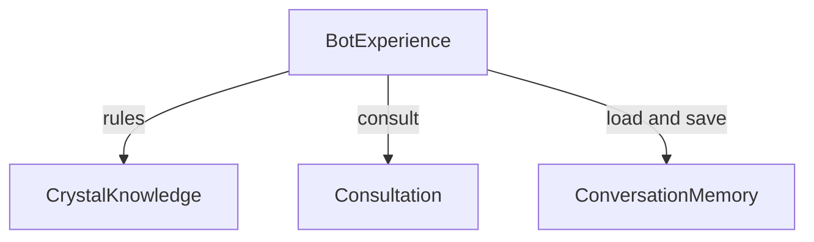

# Zona Crystal — 邏輯元件、資料擁有權與完整功能對照

## Sources

- [requirements.md](../requirements-analysis/requirements.md)：全部 FR／NFR、全功能與原有行為。
- [stories.md](../user-stories/stories.md)：17 個故事、52 個 AC 與非循環建置依賴界線。
- [team-practices.md](../practices-discovery/team-practices.md)：一天、重用、test-after、最小安全與證據。
- [domain-design-questions.md](domain-design-questions.md)：已確認四個元件、六個實體及採用方向。
- [mockups.md](../refined-mockups/mockups.md)、[interaction-spec.md](../refined-mockups/interaction-spec.md)：C1–C7、S1–S8 與375／1280互動交接。
- 此工作記錄為 Greenfield；沒有 reverse-engineering 的 architecture／component-inventory 產出，不捏造不存在的上游文件。原程式與素材重用依已核准需求。

## Component Catalogue

下列 YAML 是本階段元件／實體的唯一宣告來源。四個元件是程式責任區塊，不是四個部署服務；技術、部署、完整型別／驗證 schema 與外部協定由後續適用階段定義。

```yaml
components:
  - name: BotExperience
    summary: 協調同一 Bot 的 LINE 與本機互動、結果呈現與教學交付
    behaviour: 驗簽後使用 LINE 來源身分；本機 A／B 限教學。先處理入口與 Echo 進出，再依動作讀取必要記憶、執行內容規則或諮詢，呈現結果及保存必要變化。雙選單、生日與生命靈數捷徑、等待及安全素材呈現維持原行為。未知事件不假造成功回覆；真實失敗不轉成成功範例。
    responsibilities:
      - 入口事件／本機動作正規化、身分來源與請求生命週期
      - Echo 進出／回聲、雙選單／分享連結、LINE 回覆與動畫動作
      - C1–C7 視圖、繁體中文狀態、鍵盤／標籤與素材文字替代
      - 跨區塊協調、有限等待復原、範例證據標示、教學文件／檢查／診斷整合
    depends_on:
      - component: CrystalKnowledge
        interaction: 取得生日規則、生命靈數、水晶卡／介紹與指南
        style: sync
      - component: Consultation
        interaction: 以當前使用者必要上下文取得文字／圖片回覆、角色與三追問
        style: async
      - component: ConversationMemory
        interaction: 讀取與保存當前使用者必要狀態，不直接存取儲存內容
        style: async
    dependents: []
    external_dependencies:
      - name: LINE Messaging API
        kind: third-party-api
        purpose: 驗證平台事件，取得圖片、回覆、切換選單與 Loading Animation；沿用原串接
      - name: 本機瀏覽器與公開素材
        kind: other
        purpose: 教學操作與已有圖片呈現；只提供公開資料
    entities:
      - name: Interaction
        identifier: interactionId
        attributes:
          - interactionId
          - source
          - userKey
          - action
          - input
          - result
          - status
          - evidenceLabels
        references:
          - entity: UserConversation
            owned_by: ConversationMemory
            relationship: 互動只使用當前身分的必要對話資料
  - name: CrystalKnowledge
    summary: 管理原水晶與指南內容及生日／生命靈數／三卡規則
    behaviour: "辨識既有生日形式並驗證真實曆日，不加年齡限制；生日數字反覆縮減至1–9，不保留11／22／33。由原七款池取三個不同水晶，選卡回對應介紹；保留 #水晶／今日水晶推薦及六個指南入口。內容是教學情境，不新增療效或命運判斷。"
    responsibilities:
      - 生日辨識與公曆有效性、生命靈數及既有教學說明
      - 七款水晶、三卡選取、選卡識別與對應介紹
      - 指南別名與內容；給入口呈現捷徑／動作所需資訊
    depends_on: []
    dependents:
      - component: BotExperience
        interaction: 取得生日規則、生命靈數、水晶卡／介紹與指南
    external_dependencies:
      - name: 原水晶圖片來源
        kind: other
        purpose: 沿用既有圖片URL；圖失敗仍有名稱、文字與動作
    entities:
      - name: Crystal
        identifier: crystalId
        attributes:
          - crystalId
          - name
          - summary
          - imageUrl
          - introduction
          - labels
      - name: Guide
        identifier: guideKey
        attributes:
          - guideKey
          - label
          - aliases
          - content
          - actions
  - name: Consultation
    summary: 產生文字／圖片諮詢、三追問及四角色內容
    behaviour: 使用入口提供的當前使用者必要文字／生日／歷史與圖片進行諮詢，保留既有真實模型路徑。本機固定文字／圖片如實標示；真實模型失敗回報失敗，追問失敗提供三個相關明示替代題。有效角色採原 sender／頭像，未知角色回 COSMOS，移除一般內容中的技術角色標記。
    responsibilities:
      - 文字／圖片諮詢及可辨認的真實／教學路徑
      - 三個相關追問及教學替代標示
      - 四角色主題規則、名稱與頭像設定；錯誤交接
    depends_on: []
    dependents:
      - component: BotExperience
        interaction: 以當前使用者必要上下文取得文字／圖片回覆、角色與三追問
    external_dependencies:
      - name: 既有模型 API
        kind: third-party-api
        purpose: 沿用原文字、圖片及追問／角色呼叫；憑證另由設定取得
    entities:
      - name: DeityProfile
        identifier: roleKey
        attributes:
          - roleKey
          - senderName
          - iconUrl
          - topics
  - name: ConversationMemory
    summary: 唯一管理依使用者隔離的必要持久狀態與歷史
    behaviour: 讀回後才更新必要對話、生日與回覆／圖片描述，重啟不能用空初始狀態覆寫。所有存取按入口提供的可信身分隔離；不保存圖片原檔或秘密，保留到依文件重設。空歷史、讀取失敗、保存失敗分開回報；讀取失敗不把未知既有記憶當空檔覆寫，入口可繼續非持久諮詢並明示狀態。
    responsibilities:
      - UserConversation 與 ConversationTurn 唯一寫入／讀回及身分隔離
      - 重啟持久性、必要狀態變化與明確保存結果
      - 既有真實持久服務與實際本機持久存取邊界
    depends_on: []
    dependents:
      - component: BotExperience
        interaction: 讀取與保存當前使用者必要狀態，不直接存取儲存內容
    external_dependencies:
      - name: 本機持久儲存
        kind: other
        purpose: 無金鑰模式以實際持久資料驗證重啟；具體選型後續決定
      - name: 既有持久記憶服務
        kind: third-party-api
        purpose: 保留真實持久服務串接及失敗回報；具體協定後續確認
    entities:
      - name: UserConversation
        identifier: userKey
        attributes:
          - userKey
          - birthday
          - mode
          - menu
          - recommendationIds
          - selectedCrystalId
          - turns
        references:
          - entity: Crystal
            owned_by: CrystalKnowledge
            relationship: 保存本次推薦／被選水晶的識別以回到同一組卡
      - name: ConversationTurn
        identifier: turnId
        attributes:
          - turnId
          - userKey
          - inputText
          - replyText
          - imageDescription
          - senderRole
          - evidenceLabels
          - createdAt
        references:
          - entity: DeityProfile
            owned_by: Consultation
            relationship: 以角色識別記錄本回合 sender 的來源
```

## Component Diagram



文字替代：BotExperience 單向呼叫 CrystalKnowledge 的內容／生日規則、Consultation 的諮詢與角色、ConversationMemory 的必要資料讀寫。其餘三個元件沒有反向或互相呼叫；每個依賴都在 YAML 的被依賴清單對稱列出。

rules 為本地規則呼叫；consult 與 load and save 是等待完成的非同步結果交接，不引入訊息匯流排、事件平台或背景工作。這是邏輯互動樣式，不是公共 API／Unit DAG 或部署決策。

## Component Summary

| Component | Purpose | Depends On | Dependents | Entities Owned |
|---|---|---|---|---|
| BotExperience | 協調同一 Bot 的 LINE 與本機互動、結果呈現與教學交付 | CrystalKnowledge、Consultation、ConversationMemory | — | Interaction |
| CrystalKnowledge | 管理原水晶與指南內容及生日／生命靈數／三卡規則 | — | BotExperience | Crystal、Guide |
| Consultation | 產生文字／圖片諮詢、三追問及四角色內容 | — | BotExperience | DeityProfile |
| ConversationMemory | 唯一管理依使用者隔離的必要持久狀態與歷史 | — | BotExperience | UserConversation、ConversationTurn |

## Entity Ownership

只列擁有者、識別、屬性名稱與跨元件引用。此表不定義資料型別、欄位允許值、關聯基數或完整驗證 schema；生日有效性等規則是已核准業務行為，後續精確 schema 仍待 Functional Design。

| Entity | Owning Component | Identifier | Attributes | References |
|---|---|---|---|---|
| Interaction | BotExperience | interactionId | interactionId、source、userKey、action、input、result、status、evidenceLabels | ConversationMemory.UserConversation：互動只使用當前身分的必要對話資料 |
| Crystal | CrystalKnowledge | crystalId | crystalId、name、summary、imageUrl、introduction、labels | — |
| Guide | CrystalKnowledge | guideKey | guideKey、label、aliases、content、actions | — |
| DeityProfile | Consultation | roleKey | roleKey、senderName、iconUrl、topics | — |
| UserConversation | ConversationMemory | userKey | userKey、birthday、mode、menu、recommendationIds、selectedCrystalId、turns | CrystalKnowledge.Crystal：保存本次推薦／被選水晶的識別以回到同一組卡 |
| ConversationTurn | ConversationMemory | turnId | turnId、userKey、inputText、replyText、imageDescription、senderRole、evidenceLabels、createdAt | Consultation.DeityProfile：以角色識別記錄本回合 sender 的來源 |

Interaction 是短期互動資料，不因列入此表而要求保存原圖片。UserConversation 管理生日、模式、選單及本次卡片識別；ConversationTurn 管理必要文字／回覆／圖片描述。BotExperience 提交必要變化，由 ConversationMemory 實際更新；沒有其他元件直接寫儲存或共享可變全域歷史。Crystal、Guide、DeityProfile 沿用既有內容／設定，不建立新增管理後台。

## External Dependencies

| Component | Dependency | Kind | Purpose |
|---|---|---|---|
| BotExperience | LINE Messaging API | third-party-api | 驗證平台事件，取得圖片、回覆、切換選單與 Loading Animation；沿用原串接 |
| BotExperience | 本機瀏覽器與公開素材 | other | 教學操作與已有圖片呈現；只提供公開資料 |
| CrystalKnowledge | 原水晶圖片來源 | other | 沿用既有圖片URL；圖失敗仍有名稱、文字與動作 |
| Consultation | 既有模型 API | third-party-api | 沿用原文字、圖片及追問／角色呼叫；憑證另由設定取得 |
| ConversationMemory | 本機持久儲存 | other | 無金鑰模式以實際持久資料驗證重啟；具體選型後續決定 |
| ConversationMemory | 既有持久記憶服務 | third-party-api | 保留真實持久服務串接及失敗回報；具體協定後續確認 |

外部依賴不是領域元件。本機與真實模式的界線由入口明確區分；真實 LINE／模型／持久記憶路徑都保留，憑證及實測另記。缺少憑證不影響明示範例的本機教學，不能推定外部已通過。

## Responsibilities & Failure Handoff

### BotExperience

驗簽後使用 LINE 來源身分；本機 A／B 限教學。先處理入口與 Echo 進出，再依動作讀取必要記憶、執行內容規則或諮詢，呈現結果及保存必要變化。雙選單、生日與生命靈數捷徑、等待及安全素材呈現維持原行為。未知事件不假造成功回覆；真實失敗不轉成成功範例。

- 入口事件／本機動作正規化、身分來源與請求生命週期
- Echo 進出／回聲、雙選單／分享連結、LINE 回覆與動畫動作
- C1–C7 視圖、繁體中文狀態、鍵盤／標籤與素材文字替代
- 跨區塊協調、有限等待復原、範例證據標示、教學文件／檢查／診斷整合

### CrystalKnowledge

辨識既有生日形式並驗證真實曆日，不加年齡限制；生日數字反覆縮減至1–9，不保留11／22／33。由原七款池取三個不同水晶，選卡回對應介紹；保留 #水晶／今日水晶推薦及六個指南入口。內容是教學情境，不新增療效或命運判斷。

- 生日辨識與公曆有效性、生命靈數及既有教學說明
- 七款水晶、三卡選取、選卡識別與對應介紹
- 指南別名與內容；給入口呈現捷徑／動作所需資訊

### Consultation

使用入口提供的當前使用者必要文字／生日／歷史與圖片進行諮詢，保留既有真實模型路徑。本機固定文字／圖片如實標示；真實模型失敗回報失敗，追問失敗提供三個相關明示替代題。有效角色採原 sender／頭像，未知角色回 COSMOS，移除一般內容中的技術角色標記。

- 文字／圖片諮詢及可辨認的真實／教學路徑
- 三個相關追問及教學替代標示
- 四角色主題規則、名稱與頭像設定；錯誤交接

### ConversationMemory

讀回後才更新必要對話、生日與回覆／圖片描述，重啟不能用空初始狀態覆寫。所有存取按入口提供的可信身分隔離；不保存圖片原檔或秘密，保留到依文件重設。空歷史、讀取失敗、保存失敗分開回報；讀取失敗不把未知既有記憶當空檔覆寫，入口可繼續非持久諮詢並明示狀態。

- UserConversation 與 ConversationTurn 唯一寫入／讀回及身分隔離
- 重啟持久性、必要狀態變化與明確保存結果
- 既有真實持久服務與實際本機持久存取邊界

BotExperience 保持目前身分／模式及可復原的等待狀態；在途身分切換不附加另一人的結果。圖片／頭像／選單素材失敗仍有文字與動作；記憶讀取失敗時不覆寫未知原記憶，保存失敗不宣稱成功。真實模式設定不足或外部失敗如實回報；固定文字／圖片、LINE 模擬及追問替代標示靠近各結果。

## Legacy Function Mapping

| 原功能 | 責任與整合 |
|---|---|
| LINE／本機與 Echo | BotExperience 正規化入口與 Echo 進出；ConversationMemory 管理必要模式狀態 |
| 文字／圖片、角色、追問 | BotExperience 取得本次輸入／必要歷史，交 Consultation；四角色原名稱／頭像保留，三追問逐題可繼續 |
| 生日與生命靈數 | CrystalKnowledge 依原形式與公曆規則處理、縮減至1–9；入口與記憶保存有效結果／生日 |
| 三卡與選卡 | CrystalKnowledge 沿用七款池、提供三個不同卡／對應介紹；ConversationMemory 保存本次識別；BotExperience 接續 Consultation 追問 |
| #水晶／今日水晶推薦 | BotExperience 保留文字／快捷入口並取得 CrystalKnowledge 三卡，不新增生日先決條件給原入口 |
| 雙選單／指南／分享 | BotExperience 保留原素材、主與五宮格動作及分享連結；CrystalKnowledge 保留六個指南文字入口與內容 |
| 日期／生命靈數捷徑 | BotExperience 在三追問之外另保留；必要生日取自 ConversationMemory，不基於無效日期產生新內容 |
| 等待／重啟記憶／教學 | BotExperience 顯示等待及復原／教學；ConversationMemory 管理實際持久讀寫、空歷史與A／B隔離 |

水晶池為紫水晶、粉晶、黃水晶、綠幽靈、白水晶、黑曜石、鈦晶；COSMOS 沿用「星曜守護導師 艾蓮」。模型判斷品質及 LINE 原生畫面尚待實測，本地例子不取代外部證據。

## Rationale

| 元件 | 分開的理由 |
|---|---|
| BotExperience | 入口／平台呈現與互動生命週期；UI C1–C7 不各自拆成領域元件 |
| CrystalKnowledge | 確定性生日／卡片規則與原內容，可獨立驗證，不隨模型或儲存實作變動 |
| Consultation | 模型與教學範例、角色及追問有不同錯誤／變動來源；需要替身驗證文字與圖片分支 |
| ConversationMemory | 唯一資料擁有權、重啟及身分隔離需要獨立實際持久測試，不能散落於每種功能 |

Option A 四區塊：少量可測邊界、容易重用，代價是入口負責協調多種動作。Option B 七個舊 repo 各一區塊：來源對照直觀，但入口及整合重複。Option C 全部混在一區塊：初期組裝少，但外部失敗／記憶擁有權難以隔離。採已確認 A；邊界可在同一程式調整，不承諾獨立部署。

**Alternatives Rejected**：不按七個 repo 建七套入口，也不讓內容／模型／入口各自改寫同一記憶。詳見 [decisions.md](decisions.md) 的 ADR-001／ADR-002。沒有刻意依賴循環。

## Story Coverage & Test Handoff

| 故事 | 主責元件／實體 |
|---|---|
| US1.1 | BotExperience |
| US1.2 | BotExperience |
| US2.1 | Consultation |
| US2.2 | Consultation |
| US3.1 | ConversationMemory |
| US3.2 | ConversationMemory |
| US4.1 | Consultation |
| US4.2 | BotExperience |
| US5.1 | DeityProfile |
| US6.1 | BotExperience |
| US6.2 | Guide |
| US7.1 | BotExperience |
| US8.1 | CrystalKnowledge |
| US8.2 | CrystalKnowledge |
| US9.1 | Crystal |
| US10.1 | BotExperience |
| US10.2 | BotExperience |

[traceability.json](traceability.json) 使用同一17個故事ID與已宣告元件／實體。主責映射不表示不需整合：依 stories.md 的全部52個 AC，在同一新版驗證逐日期形式／閏日／生命靈數、逐卡／逐追問／四角色、Echo、選單／六指南、等待失敗復原，以及實際持久重啟／A與B隔離。教學交付與共用本機／CI檢查由 BotExperience 的整合責任承接，每個可測元件保留正常路徑與逐需求檢查。

## Assumptions & Open Questions

None. 全部原功能與17故事都有責任落點；本階段未選部署／儲存／套件、未定公開 API 或完整 schema，也未生成應用程式／執行功能測試。外部憑證及真實服務／LINE手機效果待驗證，按既有邊界如實交付。
